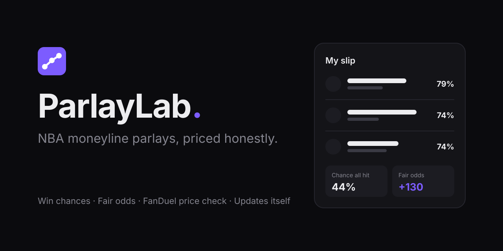

#  Parlay Lab

A small web app for building NBA moneyline parlays, made to sit beside FanDuel Sportsbook. It shows each game on the slate with a win chance for both teams, lets you pick winners, and checks FanDuel's price against fair odds before you bet.

**Open it:** https://inodhop.github.io/parlay-lab/

## What it does

- **Games.** Every game on the current slate, with each team's record, last few results and win chance. Tap Pick on the team you think wins.
- **Best bets.** The same games sorted by strongest favourite.
- **Auto-build.** Picks the most likely winners, one per game, for a 2 to 6 leg parlay above a minimum win chance you choose.
- **Slip.** Shows the chance all your picks hit and the fair odds. Type the moneyline FanDuel shows for each pick and the amount you want to bet: it works out FanDuel's parlay odds, how much you would win, and whether the price beats the model.
- **Teams.** All 30 teams ranked by strength. Follow teams to see their games under Following.

## It updates itself

There is no server and nothing to maintain. Each time the page is open it loads the schedule, scores and team records from ESPN's public scoreboard data, and refreshes every five minutes. When a day's games are finished it moves to the next day with games. If the data can't be reached it shows the last saved copy and says so.

Picks, followed teams and the last update are saved in your browser only.

## How the win chance is worked out

1. Each team's win-loss record becomes a strength rating, pulled toward 50% so a short season doesn't overreact.
2. The two ratings are compared, and the home team gets a small boost.
3. When ESPN lists a sportsbook moneyline for the game, that line is converted to a win chance and averaged with the record-based estimate. The feed's line usually comes from a different sportsbook than FanDuel, which is why you enter FanDuel's own numbers on the slip.

The parlay chance is the leg chances multiplied together. It is a simple model: it knows nothing about injuries, rest days or matchups.

## Running it yourself

The whole app is one file, `index.html`, with no build step and no dependencies. Open it in a browser, or host it on any static host.

## Caveats

- ESPN's data feed is unofficial and undocumented. It could change or stop working without notice.
- Independent project: not affiliated with or endorsed by FanDuel, ESPN, the NBA or any team. Team logos are the property of their owners and are loaded from ESPN, not stored here.
- This is a hobby tool, not betting advice. No model makes parlays safe, and every extra leg lowers the chance of a win. If you bet, keep stakes small and only where it is legal for you.
